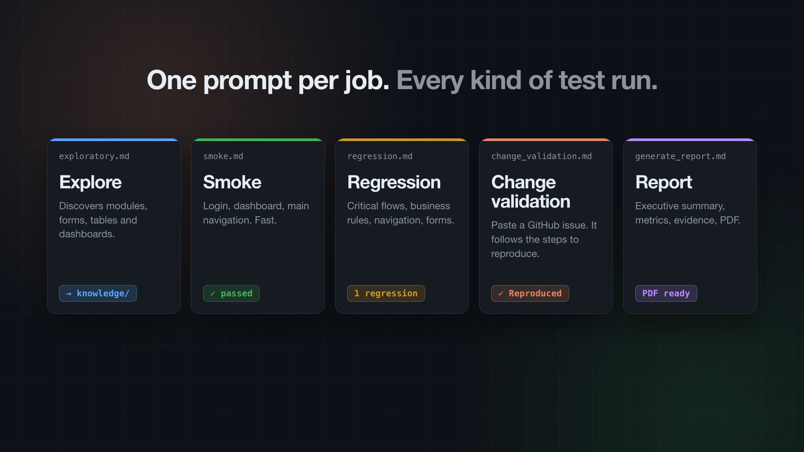

<div align="center">

# 🎭🤖 QA Agent Template

### Claude + Playwright MCP — un tester con IA que **recuerda tu aplicación**

[](https://github.com/GonzaloAlarconRoldan/GUI-PlaywrightMCP-Framework/actions/workflows/ci.yml)
[](LICENSE)
[](https://github.com/GonzaloAlarconRoldan/GUI-PlaywrightMCP-Framework/stargazers)

[English](README.md) · **Español**



</div>

---

## ¿Por qué?

La mayoría de los agentes de testing con IA **vuelven a descubrir la aplicación desde cero en cada ejecución**: gastan tokens y dan resultados inconsistentes.

Esta plantilla le da al agente una **base de conocimiento persistente** (`knowledge/`) que escribe una vez durante la exploración y reutiliza en cada ejecución. Con cada release es más rápido, más barato y más consistente.

## ✨ Funcionalidades

- 🔍 **Testing exploratorio** que genera mapa de la app, flujos, reglas de negocio e inventario de UI
- 💨 **Smoke** y 🔁 **regresión** basados en ese conocimiento
- 🐛 **Validación de cambios desde la URL de un issue de GitHub**
- 📄 **Reportes PDF** con resumen ejecutivo, capturas, errores de consola y métricas
- 🔐 **Login persistente** con storage state de Playwright

## 🚀 Inicio rápido

```bash
git clone https://github.com/GonzaloAlarconRoldan/GUI-PlaywrightMCP-Framework.git mi-qa-agent
cd mi-qa-agent
npm install
npm run setup          # instala Chromium y crea credentials.yaml local

# Completa project_config/application.yaml, credentials.yaml y knowledge/testing_scope.md
claude                 # CLAUDE.md y .mcp.json se cargan solos
```

Luego pídele al agente:

```text
Execute prompts/exploratory.md
```

| Prompt | Qué hace |
|---|---|
| `exploratory.md` | Descubre módulos, formularios, tablas y flujos |
| `smoke.md` | Login, dashboard, navegación principal |
| `regression.md` | Flujos críticos, reglas de negocio, formularios |
| `change_validation.md` | Pega la URL de un issue → intenta reproducirlo |
| `generate_report.md` | Genera el reporte HTML + PDF |

📖 Guía completa (en inglés): [docs/GUIDE.md](docs/GUIDE.md)

## ⭐ Apoya el proyecto

Si esta plantilla te ahorra tiempo, **dale una estrella** — ayuda a que más QAs la encuentren.

## 📝 Licencia

[MIT](LICENSE) © Gonzalo Alarcón Roldán
