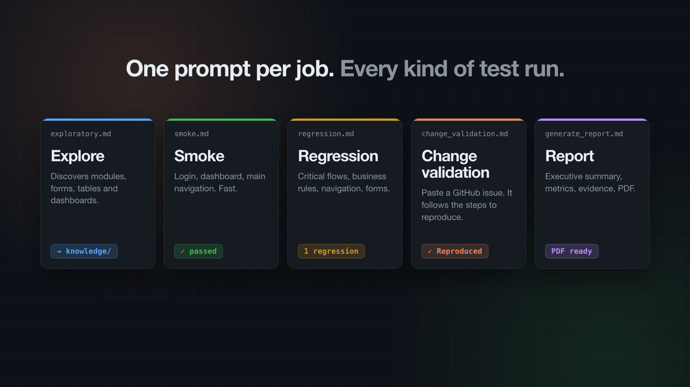
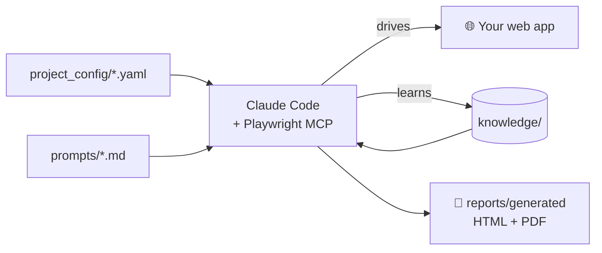

<div align="center">

# 🎭🤖 QA Agent Template

### Claude + Playwright MCP — an AI tester that **remembers your app**

[](https://github.com/GonzaloAlarconRoldan/GUI-PlaywrightMCP-Framework/actions/workflows/ci.yml)
[](LICENSE)
[](https://github.com/microsoft/playwright-mcp)
[](https://claude.com/claude-code)
[](package.json)
[](CONTRIBUTING.md)
[](https://github.com/GonzaloAlarconRoldan/GUI-PlaywrightMCP-Framework/stargazers)

**English** · [Español](README.es.md)



</div>

---

## Why?

Most AI testing setups **rediscover your application from scratch on every run** — burning tokens and producing inconsistent results.

This template gives the agent a **persistent knowledge base** (`knowledge/`) that it writes once during exploration and reuses on every later run. Each release, it gets faster, cheaper and more consistent.

| Without this template | With this template |
|---|---|
| Agent re-explores the app every run | Reads `app_map.md`, `user_flows.md`, `business_rules.md` |
| Reports known bugs again and again | Skips anything in `known_issues.md` |
| Ad-hoc prompts, ad-hoc output | One prompt per job, standard PDF report |
| No history between releases | `knowledge/releases/` tracks what changed |

## ✨ Features

- 🔍 **Exploratory testing** that builds an app map, user flows, business rules and UI inventory
- 💨 **Smoke** and 🔁 **regression** runs driven by that knowledge
- 🐛 **Change validation from a GitHub issue URL** — the agent reads the issue and tries to reproduce it
- 📄 **PDF reports** with executive summary, screenshots, console errors and metrics
- 🔐 **Persistent login** via Playwright storage state
- 🧠 **Token-efficient**: knowledge first, exploration only when asked

## ⚙️ How it works



## 🚀 Quick start

**Requirements:** Node 20+, [Claude Code](https://claude.com/claude-code) (or Claude Desktop with MCP).

```bash
# 1. Use this template (or clone it)
git clone https://github.com/GonzaloAlarconRoldan/GUI-PlaywrightMCP-Framework.git my-qa-agent
cd my-qa-agent

# 2. Install deps + browser, create your local credentials file
npm install
npm run setup

# 3. Fill in your app
#    project_config/application.yaml   → name, base_url, login_url
#    project_config/credentials.yaml   → test user (git-ignored)
#    knowledge/testing_scope.md        → what matters

# 4. Start Claude Code — CLAUDE.md and .mcp.json are picked up automatically
claude
```

Then just tell the agent which job to run:

```text
Execute prompts/exploratory.md
```

## 🧰 Jobs

| Prompt | What it does | Output |
|---|---|---|
| [`exploratory.md`](prompts/exploratory.md) | Discovers modules, forms, tables, dashboards and flows | `knowledge/*` + baseline screenshots |
| [`smoke.md`](prompts/smoke.md) | Login, dashboard, main navigation | Report |
| [`regression.md`](prompts/regression.md) | Critical flows, business rules, forms | Report + regressions found |
| [`change_validation.md`](prompts/change_validation.md) | Paste a GitHub issue URL → reproduce it | Verdict + evidence |
| [`generate_report.md`](prompts/generate_report.md) | Consolidates evidence | HTML + PDF |

Example:

```text
Execute prompts/change_validation.md
Issue: https://github.com/acme/web-app/issues/142
```

## 📁 Project structure

<details>
<summary>Click to expand</summary>

```text
.
├── CLAUDE.md                 # Entry point — Claude Code loads it automatically
├── CLAUDE_SYSTEM_PROMPT.md   # Agent role and browser rules
├── CLAUDE_CONTEXT.md         # What to read before acting
├── CLAUDE_REPORTING.md       # Report format and severity levels
├── .mcp.json                 # Playwright MCP server
├── project_config/           # Your app: URLs, environments, test data, credentials
├── knowledge/                # The agent's memory of your app (auto-maintained)
│   └── releases/             # Release notes for regression comparisons
├── prompts/                  # One prompt per testing job
├── playwright/
│   ├── playwright.config.ts
│   ├── auth/                 # Saved login session (git-ignored)
│   └── tests/                # Scripted tests + framework integrity checks
├── reports/                  # templates/, generated/, evidence/
├── screenshots/baseline/     # Visual baseline
├── generate_pdf.js           # HTML → PDF
└── docs/                     # Full guide and assets
```

</details>

## 📖 Documentation

- **[Full guide](docs/GUIDE.md)** — every config and knowledge file explained, with examples
- [Contributing](CONTRIBUTING.md) · [Security](SECURITY.md) · [Changelog](CHANGELOG.md)

## 🗺️ Roadmap

- [x] Exploratory, smoke, regression, change validation and report prompts
- [x] PDF reports with screenshots
- [x] CI with framework integrity tests
- [ ] Visual regression against baseline screenshots
- [ ] Accessibility audit prompt (axe-core)
- [ ] Turn discovered flows into reusable Playwright `.spec.ts` tests
- [ ] Example project against a public demo app

Got an idea? [Open an issue](https://github.com/GonzaloAlarconRoldan/GUI-PlaywrightMCP-Framework/issues/new/choose).

## 🤝 Contributing

PRs are welcome — new prompts and report templates are the easiest place to start. See [CONTRIBUTING.md](CONTRIBUTING.md).

## ⭐ Support

If this template saves you time, **give it a star** — it helps other QA engineers find it.

[](https://star-history.com/#GonzaloAlarconRoldan/GUI-PlaywrightMCP-Framework&Date)

## 📝 License

[MIT](LICENSE) © Gonzalo Alarcón Roldán
